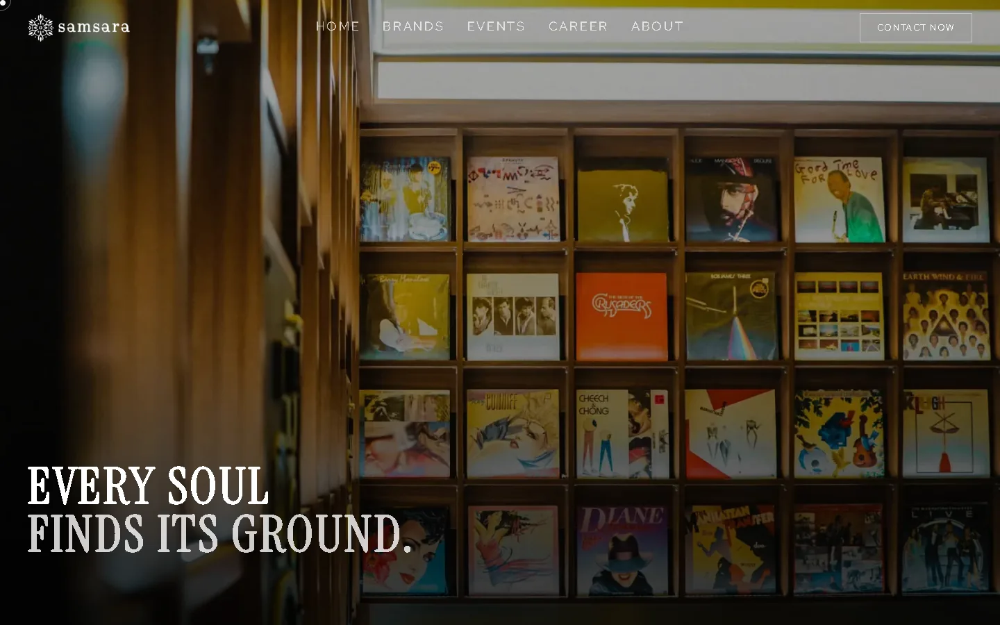

# Samsara Group — Website

[](https://github.com/albiruby/samsaragroup-website/actions/workflows/ci.yml)
[](https://github.com/albiruby/samsaragroup-website/actions/workflows/smoke.yml)
[](https://github.com/albiruby/samsaragroup-website/actions/workflows/uptime.yml)

Situs profil **Samsara Group** — satu codebase untuk lima brand: **Samsara**, **Svarga**, **Acasa**, **Outpace**, dan **Grove**.

| | |
|---|---|
| **Produksi** | https://samsaragroup.vercel.app |
| **Studio CMS** | https://samsaragroup.sanity.studio |



## Tumpukan

| Lapisan | Teknologi |
|---|---|
| Framework | Next.js 16 (App Router) |
| UI | React 19, Tailwind CSS v4 |
| CMS | Sanity v6 — konten dibaca lewat GROQ, gambar dari CDN Sanity |
| Peta | Leaflet, dimuat dinamis di `/contact` |
| Tipografi | Instrument Serif (display) + Red Hat Display (body), di-host sendiri lewat `next/font` |
| Analitik | Vercel Analytics dan Speed Insights |
| Hosting | Vercel |
| Otomasi | GitHub Actions — CI, smoke produksi harian, uptime tiap 15 menit |

## Menjalankan lokal

Prasyarat: **Node.js 24.22.1** (tercatat di `.nvmrc`; versi ini memuat patch keamanan Node.js 21 Oktober 2026) dan npm 11+.

```bash
npm ci
npm run dev        # http://localhost:3000
```

Studio CMS ada di repo terpisah, `../studio`:

```bash
cd ../studio
npm ci
npm run dev        # http://localhost:3333
```

## Skrip

| Perintah | Fungsi |
|---|---|
| `npm run dev` | Server pengembangan |
| `npm run build` | Build produksi |
| `npm run start` | Menjalankan hasil build |
| `npm run lint` | ESLint — target 0 error |
| `npm run smoke` | 74 pemeriksaan terhadap situs produksi: rute, tag SEO, header keamanan, sitemap, dan jumlah elemen yang berasal dari CMS |

## Struktur

```text
src/
├─ app/          rute App Router: /, /about, /brands, /career, /events, /contact,
│                lima halaman brand, dan /[slug]
├─ components/   komponen UI — header, hero, menu, peta, transisi, counter
├─ lib/          helper situs, JSON-LD, dan salinan teks brand
└─ sanity/lib/   klien GROQ dan pembangun URL gambar
public/          aset statis per brand: ASSETS-SAMSARA, ASSETS-SVARGA, ASSETS-ACASA
scripts/         should-build.mjs (guard deploy Vercel) dan smoke.mjs
docs/            dokumentasi lengkap
```

## Deploy dan lingkungan

- Push ke `master` → Vercel build dan deploy otomatis.
- Preview deployment memakai dataset `staging` dan diberi `noIndex`.
- Perubahan **schema** Studio → `npm run deploy` di repo `studio`.
- Perubahan **isi dokumen** → tidak perlu deploy apa pun, tampil dalam ±1 menit.
- `vercel.json` menjalankan `scripts/should-build.mjs`, sehingga push yang hanya menyentuh `docs/` melewati build.

Studio adalah **sumber kebenaran** konten: tidak ada sinkronisasi otomatis dari kode ke CMS. `SANITY_API_TOKEN` tidak dibutuhkan situs — jangan menaruhnya di `src/`, karena apa pun yang masuk bundel browser akan terekspos.

## Dokumentasi

| Dokumen | Isi |
|---|---|
| [`docs/DOCUMENTATIONS.md`](docs/DOCUMENTATIONS.md) | arsitektur, model konten, aturan bisnis, cookbook |
| [`docs/PEMELIHARAAN.md`](docs/PEMELIHARAAN.md) | panduan operasional ringkas |
| [`docs/HANDOVER.md`](docs/HANDOVER.md) | checklist serah terima dan kalender perawatan |
| [`docs/ROLLBACK.md`](docs/ROLLBACK.md) | prosedur rollback produksi |
| [`docs/Sanity CMS Tutorial.md`](docs/Sanity%20CMS%20Tutorial.md) | panduan editor CMS |
| [`docs/Overall Codebase Security Audit.md`](docs/Overall%20Codebase%20Security%20Audit.md) | audit keamanan codebase |

## Lisensi

Proprietary — seluruh hak dilindungi. Lihat [`LICENSE`](LICENSE).
